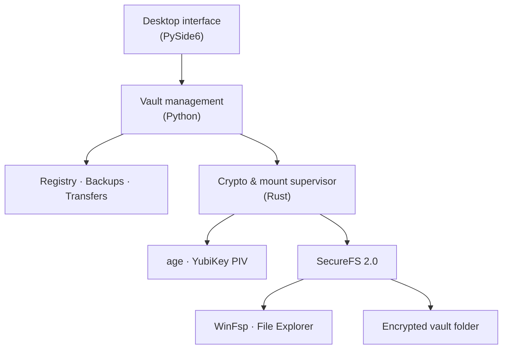

# YKA Vault Manager

A Windows desktop app for creating and managing encrypted folders with a **YubiKey**, a **recovery password**, or both. YKA uses [SecureFS](https://github.com/netheril96/securefs) for file encryption and [WinFsp](https://github.com/winfsp/winfsp) to make mounted vaults accessible in File Explorer.

## Features

- **Encrypted vaults** — Create SecureFS Lite or Full vaults and mount them to a drive letter or an empty folder.
- **Flexible unlocking** — Use a password or one of multiple authorized YubiKey PIV keys; test unlock methods without mounting.
- **Portable backups** — Export and import signed `.yka` backups, or restore an earlier backup to the same verified vault.
- **Safe file copying** — Copy files into or out of mounted vaults with optional content verification.
- **Vault sizes** — View cached encrypted-folder sizes in the vault list and General settings.
- **Safer operation handling** — Check mount locations before unlocking, isolate unresponsive YubiKeys, and recover interrupted mount sessions without closing unrelated mounts.
- **Windows integration** — System tray, saved mount preferences, vault status monitoring, and optional automatic unmount requests.

## Getting started

**Requirements:** Windows x64 and WinFsp. A YubiKey is optional for password-only vaults; creating a PIV key requires a compatible YubiKey with firmware 5.8 or later.

Use the Windows installer or portable application from a release. The installer can install WinFsp when it is missing; the portable app requires WinFsp to be installed separately.

1. Choose **Create Vault** and select a location, encryption format, and unlock method.
2. Select the vault and click **Mount**. Unlock using your password or YubiKey.
3. Use the mounted drive in **File Explorer**, then click **Unmount** when finished.
4. Use **Export Backup** to save the complete encrypted vault as a `.yka` file.

To add an existing YKA vault, select its `.yka-key` file. YKA identifies the corresponding encrypted folder automatically.

> **Back up before restoring:** Restoring a previous `.yka` replaces the current vault contents and can restore the unlock methods that existed when that backup was created.

## Architecture



The interface, vault management, and cryptographic operations are separate components. Python coordinates tasks while Rust handles unlock operations and supervises SecureFS mounts. Read-only PIV detection and signing use short-lived helpers with timeouts and cancellation; device setup remains explicitly confirmed.

## Build from source

Requires **Python 3.13 x64**, **Rust 1.99.0** with the `x86_64-pc-windows-gnu` toolchain, and **MinGW-w64 GCC**. Network access is needed to fetch pinned dependencies. Run in PowerShell from the repository root:

```powershell
py -3.13 -m venv .venv
.\.venv\Scripts\python.exe -m pip install -r requirements.lock.txt
.\.venv\Scripts\python.exe scripts/fetch_dependencies.py
rustup toolchain install 1.99.0-x86_64-pc-windows-gnu --profile minimal
$env:RUSTUP_TOOLCHAIN = '1.99.0-x86_64-pc-windows-gnu'
powershell -NoProfile -ExecutionPolicy Bypass -File scripts/build.ps1
powershell -NoProfile -ExecutionPolicy Bypass -File scripts/package.ps1
```

The portable application is generated under `dist/portable-1.2.0/`. To build the installer, also install **Inno Setup 6** and run `scripts/installer.ps1`. Install WinFsp before testing mounted vaults; building from source does not install the driver.

## Project structure

| Path | Contents |
| --- | --- |
| `src/yka/` | Desktop interface, worker, vault management, PIV and file operations |
| `native/` | Rust cryptography and mount supervisor |
| `vendor/` | Modified YubiKey plugin source and dependency manifests |
| `scripts/` | Dependency, build and packaging tools |
| `assets/`, `installer/` | App resources and installer configuration |
| `docs/` | Required third-party notices and license texts |

## Security and recovery

- Keep the **encrypted vault folder and its `.yka-key` file together**, or keep a complete `.yka` backup. A YubiKey alone cannot recover a missing key file.
- Changing or removing passwords or keys does **not** revoke access to older backups. Export a new `.yka` backup after changing unlock methods.
- Mounted files are accessible in plaintext to software with access to the mounted volume. Removing a YubiKey or putting Windows to sleep does **not** guarantee the vault is unmounted.
- Backups are authenticated, but exporting is **not an atomic filesystem snapshot**. Avoid changing the encrypted folder during export, and keep independent backups of important data.

## License

YKA Vault Manager is licensed under **GPL-3.0-only**; see [LICENSE](LICENSE). Third-party licenses, copyright notices, and source information are in [Licenses & Credits](docs/THIRD_PARTY.md). Distributions must preserve the required notices and corresponding source obligations.
